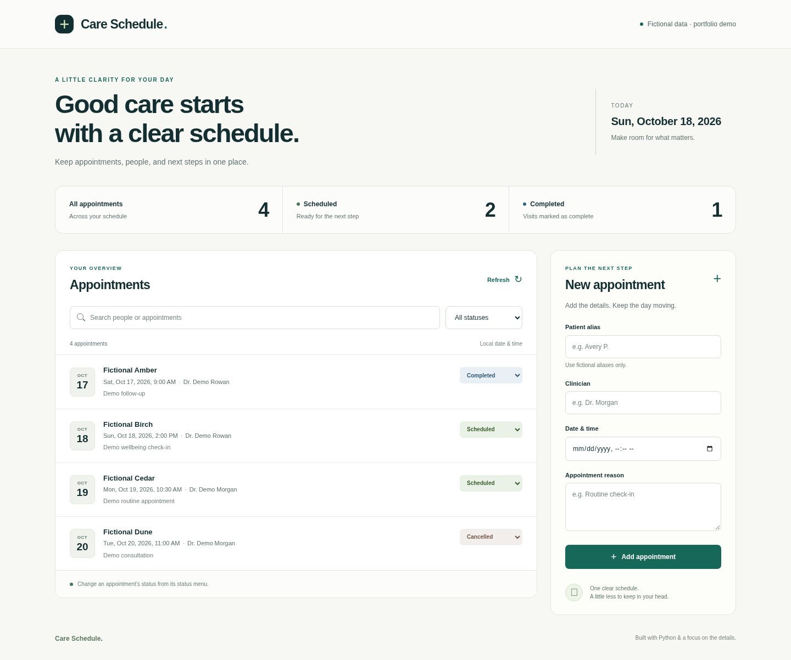

# Care Schedule

A small appointment-tracking demo built with Python’s standard library and SQLite. Create fictional appointments, search and filter the schedule, and mark appointments as scheduled, completed, or cancelled.



## Open the browser demo without Python

Download the [repository ZIP](https://github.com/Laqd99/Laqd99/archive/refs/heads/main.zip), extract it, and open `docs/index.html` from the repository's top-level folder in your browser. No server or installation is required.

The standalone demo uses fictional data stored in that browser. It does not connect to the Python API or share its SQLite database. If browser storage is unavailable, it displays a notice and keeps changes only until you close the page. Private browsing, moving the downloaded file, or clearing browser data can affect saved appointments.

To rebuild the standalone file after changing the interface, run this from the project directory:

```sh
python3 export_demo.py
```

The generated file is also ready for GitHub Pages. In the repository's **Settings → Pages**, choose **Deploy from a branch**, then **main** and **/docs**. Enablement and a successful Pages build are required before the public site is available.

## Run locally

Requires Python 3.10 or newer. No packages, credentials, or external services are needed.

```sh
cd projects/appointment-tracker
python3 app.py
```

Open <http://127.0.0.1:8080> in your browser. The server listens on the local loopback interface by default. Stop it with `Ctrl+C`.

A new database starts with fictional example appointments. Changes persist in `.local/appointments.sqlite3` across restarts. You can choose a different port or database file:

```sh
python3 app.py --port 8081 --database .local/demo.sqlite3
```

Appointment times are local wall-clock dates and times, such as `2030-05-20T09:00`; they do not include a time zone or perform time-zone conversion.

## API

| Method | Path | Purpose |
| --- | --- | --- |
| `GET` | `/api/health` | Check server health. |
| `GET` | `/api/appointments` | List appointments. |
| `POST` | `/api/appointments` | Create an appointment. |
| `PATCH` | `/api/appointments/<id>` | Update an appointment’s status. |

Send JSON with `Content-Type: application/json`. For example, create an appointment with:

```json
{
  "patient_alias": "Demo Patient",
  "clinician": "Demo Clinician",
  "starts_at": "2030-05-20T09:00",
  "reason": "Fictional follow-up"
}
```

To update its status, send `{"status": "completed"}` to `/api/appointments/<id>`. Valid statuses are `scheduled`, `completed`, and `cancelled`. Two scheduled appointments for the same clinician at the same time return HTTP `409`; completed and cancelled entries do not reserve that slot.

## Tests

From `projects/appointment-tracker`, run:

```sh
python3 -m unittest discover -s tests -v
```

The optional browser-storage tests use Node.js 18 or newer, with no packages:

```sh
node --test tests/test_demo_store.cjs
```

## Demo scope

This is an educational local demo with no authentication. Use fictional data only; it is not intended to store real patient information or run a clinical service.
